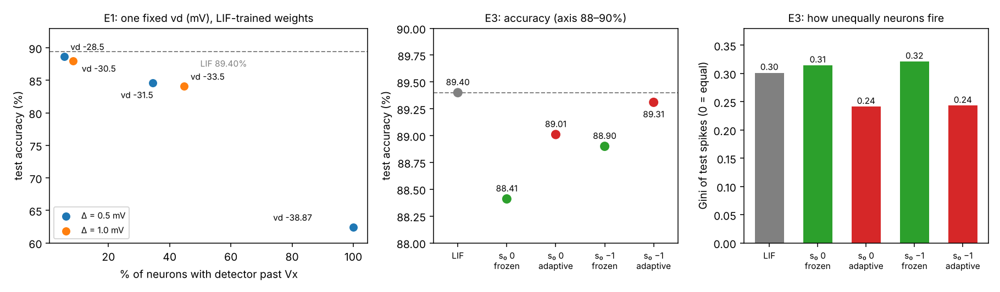
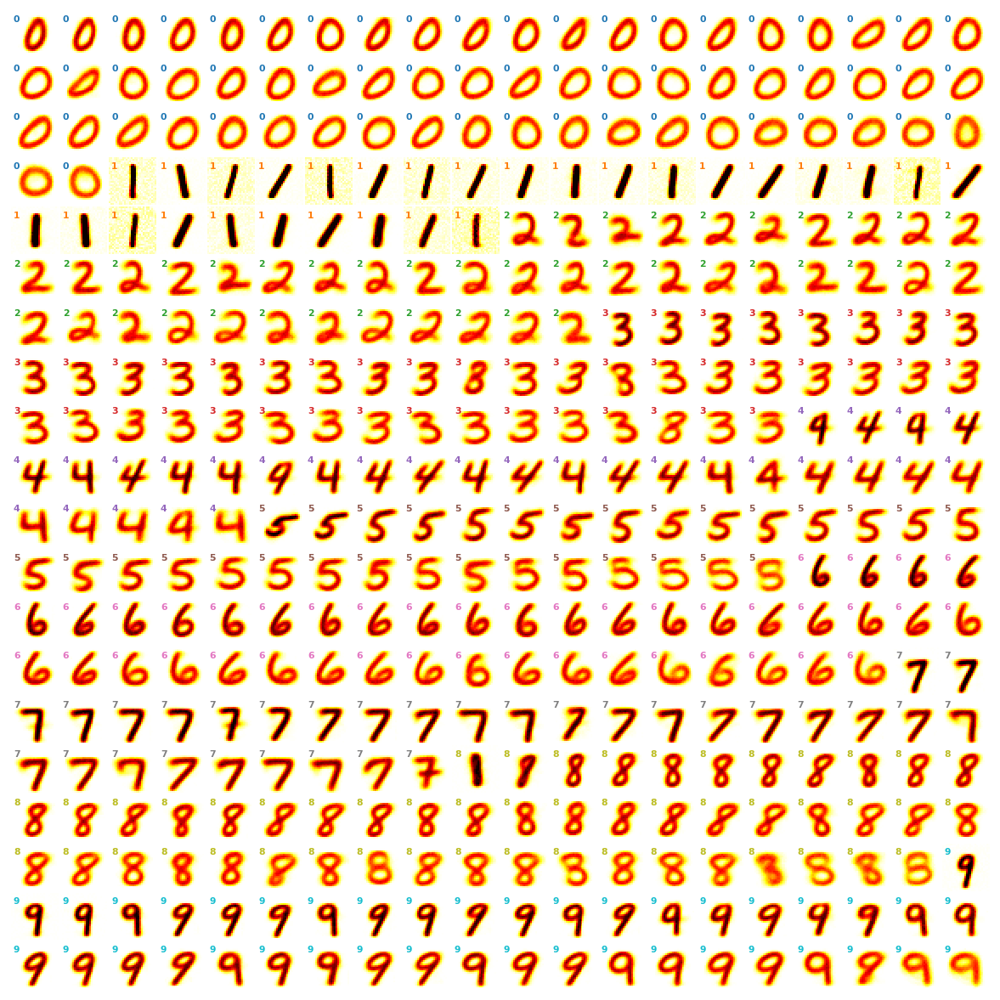
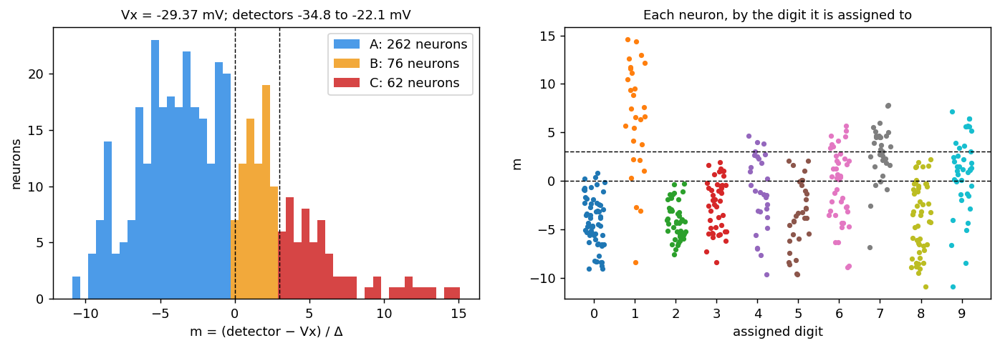
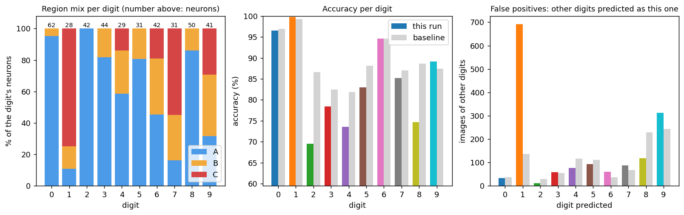
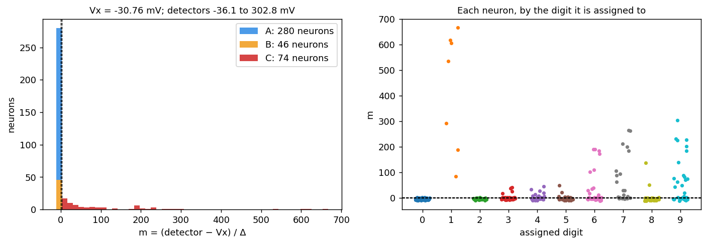
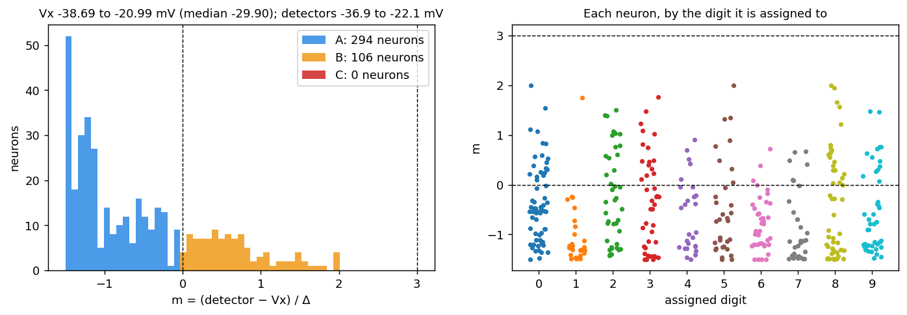
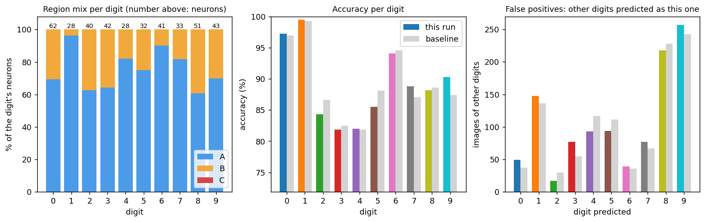
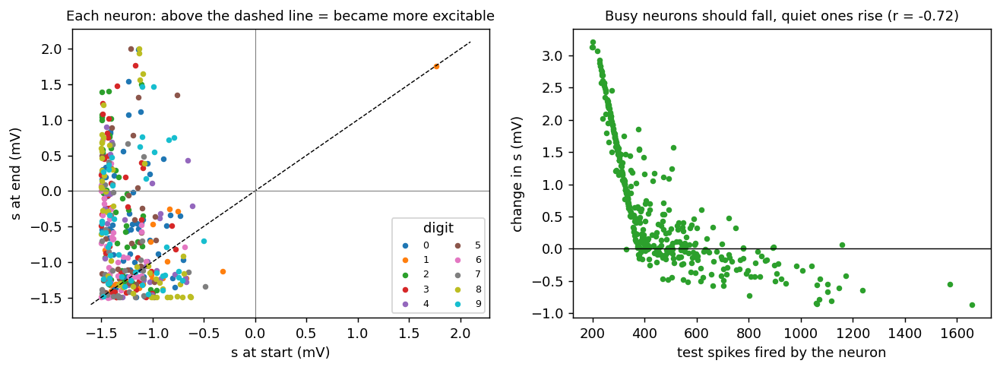
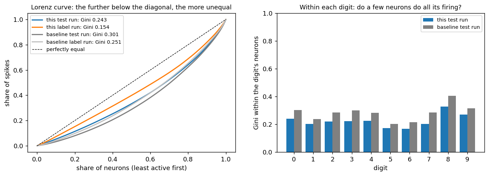

# Spike initiation and competition in an STDP winner-take-all network

Does the way a neuron starts a spike change what an unsupervised spiking network learns?

I took Diehl & Cook's (2015) STDP network for MNIST, which uses leaky integrate-and-fire (LIF) neurons, and replaced its excitatory neurons with exponential integrate-and-fire (EIF) neurons. EIF neurons have a sharp, self-accelerating spike onset, like real cortical neurons. Then I measured what the change does to competition between neurons, to homeostasis and to accuracy.

To make these experiments possible I first ported the original Brian1 code to Brian2, then rewrote it as a compiled Brian2 C++ standalone program. I also wrote tools to analyse every run.



## Main findings

All results are from 400-neuron networks evaluated on the 10,000 MNIST test images, using the paper's protocol: neurons get their labels from the 60,000 training images. Every figure below comes from the reports in [`results/`](results/README.md).

### Baseline: what the LIF network learns (89.40%)

Each excitatory neuron learns one prototype digit through STDP. Lateral inhibition makes them compete, and the adaptive threshold θ keeps any single neuron from winning every image.


*Input weights of all 400 LIF neurons, grouped by the digit each one was assigned.*

To place each EIF neuron, I use the runaway point Vx (above it, the exponential term fires the neuron by itself) and compare it with the neuron's spike detector (−72 mV + θ):
- **Region A**: the detector is below Vx, so the neuron behaves like LIF.
- **Region B**: the detector is just past Vx, so the runaway decides the spike.
- **Region C**: the detector is far past Vx, so θ no longer restrains the neuron.

### 1. One fixed spike-onset point (vd) breaks the network (E1)

With LIF-trained weights, accuracy falls as more neurons have their detector past Vx: from 88.7% to 84.6%, then to 62.4%.


*vd = −31.5 mV. Left: where each neuron sits relative to Vx. Right: the same, by assigned digit. The digit-1 neurons have the highest θ, so they are pushed furthest into region C.*


*Same run, compared with LIF (grey). 75% of the digit-1 neurons are in region C, and "1" becomes an attractor: 692 images of other digits are called "1", against 136 for LIF. Digit 2 drops from 86.6% to 69.5%. Most of those images are called "1".*

### 2. Training with a fixed vd lets neurons escape the adaptive threshold (E2)

Once θ rises past Vx, the exponential term fires the neuron before the detector is reached. Raising θ no longer slows it down, so θ keeps climbing.
- 45 neurons end with θ above 60 mV, and one reaches 375 mV. In the LIF network, θ stays at or below 50 mV.
- Those 45 neurons fire 30% of all test spikes.
- Accuracy drops to 82.4%.


*EIF-trained network. 74 neurons sit far into region C, some more than 600 Δ past Vx. Learning creates the same digit-1 attractor: 940 images wrongly called "1".*

### 3. A per-neuron homeostatic onset point fixes it (E3)

Each neuron keeps its own distance s = threshold − Vx. Every spike it fires pushes s down (less excitable), and a slow drift pushes s back up (more excitable). Vx therefore moves with the neuron's own θ, and the neuron adapts only from its own activity.

- Trained for 3 epochs, the network matches LIF when s keeps adapting during testing: 89.31% (s₀ = −1) and 89.01% (s₀ = 0), against 89.40% for LIF. McNemar tests give p = 0.72 and p = 0.09, so neither difference is significant.
- No neuron reaches region C, and θ stays at 35–50 mV, as in LIF.


*s₀ = −1, adaptive s, at the end of the test run: 294 neurons in A, 106 in B, none in C. The digit-1 neurons, the busiest, are held in A, which is LIF-like.*


*Same network, compared with LIF (grey). The region mix differs by digit: 96% of digit-1 neurons are in A, while 30–39% of the neurons for 0, 2, 3, 8 and 9 are in B. Accuracy per digit is close to LIF, and the digit-1 attractor is gone: 148 wrong "1" answers, against 136 for LIF.*

### 4. The homeostasis does what it is meant to: quiet neurons rise, busy ones fall


*Left: s of each neuron before and after the test run. Right: the change in s against how much the neuron fired. The correlation is r = −0.72: quiet neurons gained up to 3 mV of excitability, busy ones lost some.*

The rule is one-sided, though. Lowering s further only makes a neuron more LIF-like, so busy neurons sit near the floor while quiet ones climb into region B. The result is that firing is shared more evenly, without changing accuracy:


*Left: Lorenz curves; the closer to the diagonal, the more evenly neurons share the spikes. The Gini is 0.24 for EIF against 0.30 for LIF (test), and 0.15 against 0.25 (label). Right: within the neurons of each digit, EIF shares the firing more evenly than LIF for all ten digits.*

### 5. Under rate coding, the neuron model is not the bottleneck

The LIF network and all four homeostatic EIF networks make the same four main errors: 4→9, 3→8, 7→9 and 2→8. The readout counts spikes over 350 ms, which averages away exactly what EIF changes: when each spike happens.

Details, settings and every number: [docs/experiments.md](docs/experiments.md).

## What EIF adds over LIF

| | LIF | homeostatic EIF (adaptive s) |
|---|---|---|
| spike onset | hard threshold, no onset dynamics | exponential upswing, as measured in cortical neurons |
| test accuracy | 89.40% | 89.31% / 89.01% (not significantly different) |
| Gini of test spikes (0 = all neurons equal) | 0.30 | **0.24** |
| Gini of label-run spikes | 0.25 | **0.15** |
| share of spikes from the 10% busiest neurons | 22.3% | **21.3–21.6%** |
| images shown again (too few spikes), per 10,000 test images | 182 | **138–139** |
| same, per 60,000 label images | 1,185 | **883–894** |

- **Closer to biology.** Real cortical neurons start a spike with an exponential rise in voltage, not a hard threshold. EIF models fitted to recordings predict their spike times accurately (Fourcaud-Trocmé et al., 2003; Badel et al., 2008). The homeostatic rule is also biologically plausible: each neuron adapts only from its own spikes, like θ.
- **More neurons share the work.** The homeostasis lifts quiet neurons into the runaway region, so they fire more easily. That lowers the Gini and cuts repeat presentations by about 25%. Repeats are rare in both networks, so the time saved is small.
- **Why it could beat LIF.** With a spike-count readout it only matches LIF, because counting hides what EIF changes: spike timing. A sharper onset and more neurons that cross threshold easily are what a timing code needs. That is the hypothesis of the next step, not yet a result.

Note: one seed per network, and the EIF test runs used Δ = 1.0 mV after training at 0.5 mV (see Limitations).

## Next step: from rate coding to inter-spike-interval coding

Finding 5 points to the code, not the neuron. For each image the network uses about 2,300 input spikes over 350 ms and about 18 output spikes, then throws away their timing. Humans categorise an image in about 150 ms (Thorpe et al., 1996), too short for each neuron to count many spikes.

The plan: each active pixel sends **5–8 spikes within 150 ms**, with its intensity in the inter-spike interval. That needs about 750–1,200 input spikes per image, in less than half the time.

In an unsupervised STDP network on MNIST, Guo et al. (2021) found that an interval (burst) code against a rate code was:
- 5× faster at inference;
- 1.7× more economical in spikes;
- about one point more accurate.

First-spike coding is faster still and uses fewer spikes, but one lost or shifted spike destroys an input. Several intervals per input should be far more robust. The test is a matched comparison: rate vs first-spike vs ISI, LIF vs EIF, at 100–600 neurons, under jitter and spike loss.

Plan and literature: [docs/next-steps.md](docs/next-steps.md).

## From Brian1 to compiled C++

1. **Original.** Diehl & Cook's [code](https://github.com/peter-u-diehl/stdp-mnist) is written for Brian1 and Python 2, which current Python setups no longer support.
2. **My Brian2 port.** I ported it to Brian2 and Python 3. My first port gave 59.9% with the published weights: I had routed the recurrent synapses by target population instead of source, so the inhibitory neurons never fired and there was no winner-take-all. Fixing it gave about 91%, close to the published result. The port still ran the experiment as a Python loop, one image at a time, which was too slow for running many experiments.
3. **C++ standalone (this repository).** I moved the whole experiment into one compiled Brian2 C++ standalone program: showing images, retrying silent images, weight normalisation and STDP. Python only builds the network and reads the results. A full 3-epoch training now takes about 3.5 h on my Windows machine, and a 10,000-image test pass 4–7 min.

Another Brian2 port, [Diehl-Cook_2015_Brian2](https://github.com/GenevieveF/Diehl-Cook_2015_Brian2), also updates the original code to Brian2 and Python 3. Its README notes the simulation "may take many hours to run". A 2025 change to event-driven STDP sped up its training, but it still drives the experiment from Python, one image at a time. I have not timed it myself.

### What else changed

| | Original ([stdp-mnist](https://github.com/peter-u-diehl/stdp-mnist)) | My Brian2 port | This repository |
|---|---|---|---|
| Simulator | Brian1, Python 2 | Brian2, Python 3 | Brian2 C++ standalone |
| Experiment loop | Python, one image at a time | Python, one image at a time | inside the compiled program: retries, weight normalisation and STDP |
| Parameters | hard-coded | hard-coded | every one a command-line option or JSON key; all saved to `run_info.json` |
| Network size | 400 (files) | 400 | any size; wrong-size connection files are rejected, not silently loaded |
| Neuron models | LIF | LIF | LIF, or EIF with fixed, tracking or homeostatic vd |
| Evaluation | labels from the test set itself | same | paper protocol (labels from 60k training images), with checks that label and test runs match |
| Analysis | weight plots | – | HTML reports, region analysis, Gini, per-image comparison with a baseline |

Behaviour that differs on purpose:
- The retry cap is 10 (test) / 100 (train) by default; `--max-retries -1` restores Brian1's unlimited retries.
- θ decays continuously, as in Brian1.
- The C++ random-number generator differs, so results match the Python versions statistically, not spike for spike.
- When two digits get exactly the same score, the tie is broken with a stable sort. Otherwise the result depends on the numpy version: 8 of the 10,000 LIF test images are ties, enough to move the accuracy between 89.37% and 89.40%.

Times on my Windows machine, from the run logs:

| run | LIF | EIF (homeostatic) |
|---|---|---|
| training, 3 epochs (180,000 images) | – | about 3.5 h |
| label pass (60,000 images) | – | 37–39 min |
| test pass (10,000 images) | 3.8 min | 6.5–6.9 min |

## Reproduce the test results without training

`weights/` holds two trained networks: the LIF baseline and the homeostatic EIF network with s₀ = −1. It also holds the recurrent connections, and each neuron's digit label taken from my 60,000-image label runs. So you only need a test pass, about 4 min for LIF or about 7 min for EIF, plus 20–30 s to compile:

```bash
# LIF baseline (89.40%)
python code/dc_standalone.py --mode test --n-e 400 --seed 0 --weights-dir weights/LIF_400 \
       --conn-dir weights/connections --mnist-dir <mnist folder> --out-dir runs/LIF_test
python code/evaluate.py --test-dir runs/LIF_test --assignments weights/LIF_400/assignments.npy

# EIF, homeostatic s, s0 = -1, s adaptive during the test (89.31%)
python code/EIF.py --mode test --n-e 400 --seed 1 --vd-mode homeo --s-init trained --s-mode adaptive \
       --weights-dir weights/EIF_homeo_s-1 --conn-dir weights/connections --mnist-dir <mnist folder> \
       --out-dir runs/EIF_s-1_adaptive
python code/evaluate.py --test-dir runs/EIF_s-1_adaptive --assignments weights/EIF_homeo_s-1/assignments_adaptive.npy
```

- **Frozen s.** The neuron labels included are for adaptive s. For `--s-mode frozen`, run a label pass first (about 40 min) and use `--label-dir`.
- **Δ.** Leave `--delta-e-mv` at its default (1.0) to match the reported test runs (see Limitations).
- **Expected match.** With the same seed and compiler the spikes should be the same. On another platform or compiler they agree statistically, not spike for spike.

## Repository layout

```
code/        dc_standalone.py  LIF network (Brian2 C++ standalone)
             make_random_weights.py  initial weights, Diehl & Cook's rules, any size
             EIF.py            same network with EIF excitatory neurons
             evaluate.py       accuracy, paper protocol
             visualize.py      HTML report of a run
             regions.py        EIF regions A/B/C, Gini, comparison with a baseline
notebooks/   the exact commands and outputs of the final EIF runs
results/     run settings + evaluations, HTML reports, figures (index: results/README.md)
weights/     trained LIF and EIF networks + neuron labels, for test-only runs
docs/        getting-started.md, experiments.md, next-steps.md, usage.md
```

## Quick start

Needs Python 3, `pip install -r requirements.txt`, a C++ compiler and MNIST. Setup, MNIST download and initial weights are covered step by step in [docs/getting-started.md](docs/getting-started.md); every option is in [docs/usage.md](docs/usage.md).

```bash
# LIF: train, label, test, evaluate
python code/dc_standalone.py --mode train --n-e 400 --epochs 3 --out-dir runs/train400
python code/dc_standalone.py --mode label --weights-dir runs/train400/weights --out-dir runs/label400
python code/dc_standalone.py --mode test  --weights-dir runs/train400/weights --out-dir runs/test400
python code/evaluate.py --label-dir runs/label400 --test-dir runs/test400

# EIF with homeostatic vd
python code/EIF.py --mode train --vd-mode homeo --delta-e-mv 0.5 --s-init -1 --out-dir runs/eif_train
python code/EIF.py --mode test  --vd-mode homeo --delta-e-mv 0.5 --weights-dir runs/eif_train/weights \
                   --s-init trained --s-mode adaptive --out-dir runs/eif_test
```

## Limitations

- **One seed per configuration**, so the differences between E3 variants are within what a second seed could change.
- **Δ differs between training and testing in E3.** Training used Δ = 0.5 mV; the label and test runs used the default Δ = 1.0 mV. It is recorded in every `run_info.json`, and the first thing I will rerun.
- **The time step is 0.5 ms with Euler integration.** At this step the EIF equation becomes numerically unstable when many inhibitory neurons fire in the same step. This locked up my first s₀ = −1 training run after about 2,000 images. A semi-implicit update would remove the problem.

## References

- Badel, L. et al. (2008). Extracting non-linear integrate-and-fire models from experimental data using dynamic I–V curves. *Biol. Cybern.* 99:361–370.
- Diehl, P. U. & Cook, M. (2015). Unsupervised learning of digit recognition using spike-timing-dependent plasticity. *Front. Comput. Neurosci.* 9:99.
- Fourcaud-Trocmé, N., Hansel, D., van Vreeswijk, C. & Brunel, N. (2003). How spike generation mechanisms determine the neuronal response to fluctuating inputs. *J. Neurosci.* 23(37).
- Guo, W., Fouda, M. E., Eltawil, A. M. & Salama, K. N. (2021). Neural coding in spiking neural networks: a comparative study for robust neuromorphic systems. *Front. Neurosci.* 15:638474.
- Gerstner, W., Kistler, W. M., Naud, R. & Paninski, L. (2014). *Neuronal Dynamics*. Cambridge University Press.
- Stimberg, M., Brette, R. & Goodman, D. F. M. (2019). Brian 2, an intuitive and efficient neural simulator. *eLife* 8:e47314.
- Thorpe, S., Fize, D. & Marlot, C. (1996). Speed of processing in the human visual system. *Nature* 381:520–522.

## Author

Abhilash. The research questions, experiment design, runs and interpretation are mine. Parts of the code and analysis tools were written with help from an AI assistant (Claude, Anthropic).
